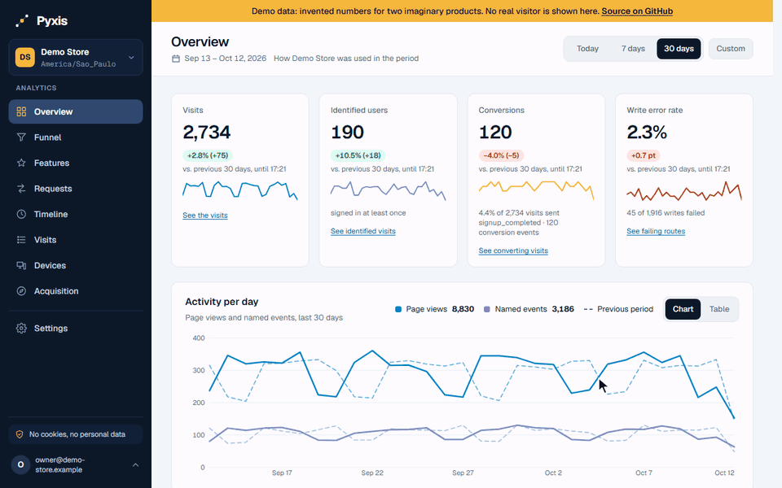
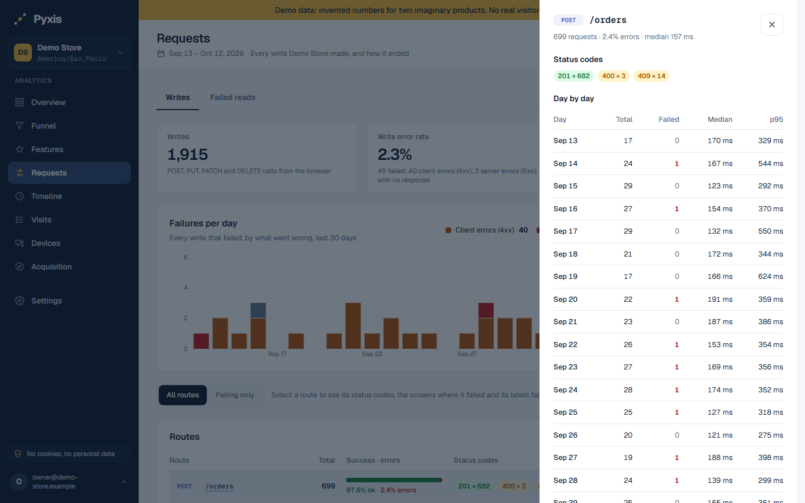
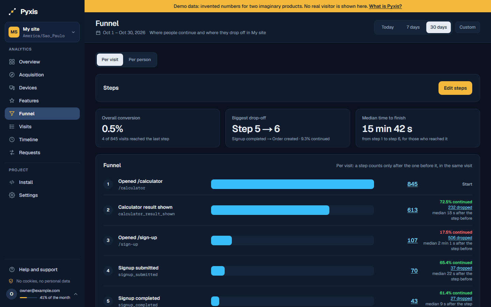
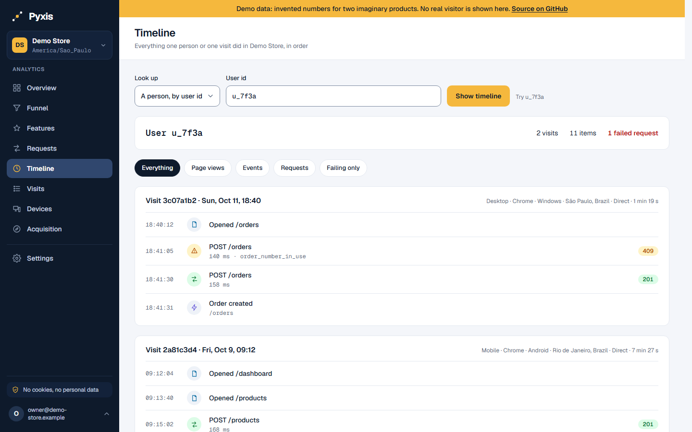
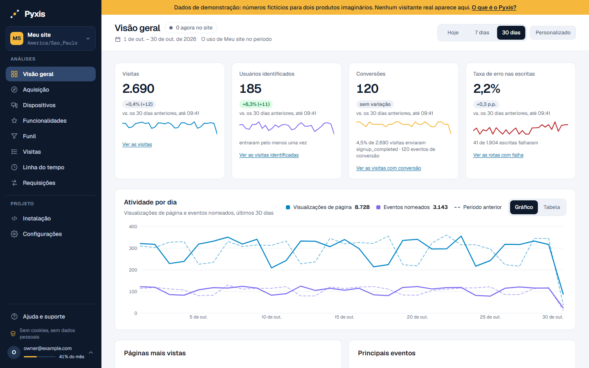
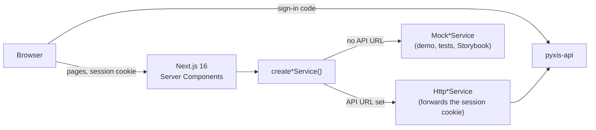

<div align="center">

<picture>
  <source media="(prefers-color-scheme: dark)" srcset=".github/assets/cover-dark.png">
  
</picture>

**The dashboard of Pyxis: the overview, funnels, features, request errors, devices, acquisition and
per-person timelines of a product, measured without cookies or personal data.**

[](https://github.com/samuelcsantana/pyxis-web/actions/workflows/ci.yml)
[](https://codecov.io/gh/samuelcsantana/pyxis-web)
[](https://github.com/samuelcsantana/pyxis-web/actions/workflows/codeql.yml)
<br>
[](LICENSE)
[](tsconfig.json)
[](https://www.conventionalcommits.org)
[](e2e)
[](https://samuelcsantana.github.io/pyxis-web/)
[](https://demo.pyxis-analytics.dev)

**[Live demo](https://demo.pyxis-analytics.dev)** ·
**[Storybook](https://samuelcsantana.github.io/pyxis-web/)** ·
**[API reference](https://samuelcsantana.github.io/pyxis-api/)** ·
**[SDK playground](https://samuelcsantana.github.io/pyxis-sdk/)**

</div>



| Requests, with a route's details                                                                                                                                                                                            | Funnel, dark theme                                                                                                                                                                                                                                                                                  | Timeline of one person                                                                                                                                                                                                                           |
| --------------------------------------------------------------------------------------------------------------------------------------------------------------------------------------------------------------------------- | --------------------------------------------------------------------------------------------------------------------------------------------------------------------------------------------------------------------------------------------------------------------------------------------------- | ------------------------------------------------------------------------------------------------------------------------------------------------------------------------------------------------------------------------------------------------ |
|  |  |  |

The tour and the screenshots show invented demo data: the dashboard runs on it when no API is
configured. The tour was recorded from the [live demo](https://demo.pyxis-analytics.dev).

> **Status:** in production since 2026-10-06 at `app.pyxis-analytics.dev` for the projects'
> admins; the same screens run on invented data in the public
> [live demo](https://demo.pyxis-analytics.dev).

## Ecosystem

| Repository                                               | Role                                                             |
| -------------------------------------------------------- | ---------------------------------------------------------------- |
| [pyxis-api](https://github.com/samuelcsantana/pyxis-api) | Ingestion, dashboard sign-in and queries, erasure, retention     |
| [pyxis-sdk](https://github.com/samuelcsantana/pyxis-sdk) | Browser tracker published to npm as `pyxis-analytics`            |
| [pyxis-mcp](https://github.com/samuelcsantana/pyxis-mcp) | MCP server: Claude and other agents read the dashboard's numbers |
| **pyxis-web** (this one)                                 | The dashboard                                                    |

## Why it exists

A product team wants to know which features are used, where requests fail, where a sign-up funnel
loses people and what one person did, in order. Pyxis answers those questions from events that
carry no cookie, no IP address and no personal data. This dashboard is where the answers are read:
one admin, one email code to sign in, and a design that puts the number that matters first.

Read more: [why Pyxis was built and what it never stores][post], the introduction post on the
author's blog, also in [Portuguese][post-pt] and [Spanish][post-es].

[post]: https://www.samuelsantana.dev/en/blog/pyxis-analytics-without-cookies-ip-or-personal-data
[post-pt]: https://www.samuelsantana.dev/blog/pyxis-analytics-sem-cookie-sem-ip-sem-dado-pessoal
[post-es]: https://www.samuelsantana.dev/es/blog/pyxis-analytics-sin-cookies-sin-ip-sin-datos-personales

## Features

Shipping now:

- The approved brand and design tokens (light and dark), exposed to Tailwind CSS 4
- A strict Content Security Policy and hardening headers on every page
- Storybook with the design tokens page, a page of every control recipe (primary, strong,
  secondary and icon buttons, segmented options, tabs, pills, links, fields) at rest, hovered,
  pressed, focused, unavailable and busy, and stories for those states; the open, busy and failed
  states of the shell (project switcher, Custom period, phone menu, Sign out) and the app's own
  empty pages under "Pages/States"; every story is also an automated accessibility test
- Every control answers the pointer and a tap: hover and pressed states of at least 1.3:1 in both
  themes, the pointer cursor on enabled buttons, colour transitions that respect reduced motion
  (an e2e check fails on anything that still moves when the system asks for less motion)
- Landmarks kept for navigation: figures and stat cards are named groups, not regions; the
  selected period, tab or filter is `aria-current="page"`; the funnel editor's status is a live
  region; a shortened user id's link name starts with the text it shows
- Form fields with a 3:1 border and 16px text on phones (so iOS does not zoom on focus); links
  whose underline thickens on hover, and row links with a visible underline and a 24px target
- Text that follows the reader's default text size: every font size is a rem token (an ESLint
  rule rejects sizes in px); with the browser's text set to 32px every text doubles, no screen
  scrolls sideways at 390 or 1280px, and wide tables scroll inside their card
- Sign-in with a six-digit code sent by email; the page never tells whether an email can sign in.
  The code goes in six cells over one real field (so the phone can offer the code it received),
  is verified as soon as the sixth digit is in, and a refused code stays selected for retyping.
  A missing email, a malformed one or an incomplete code is explained right under its field, in
  the page's language, instead of by the browser's own bubble. The code step shows the address
  the code went to with a Change button, waits 30 seconds before another code can be asked for
  (each one replaces the last, and the API sends at most five an hour), and survives a reload of
  the tab for the ten minutes a code lives (the address and the time it was sent stay in
  `sessionStorage`, forgotten on sign-in or on Change). The page names Pyxis once, in its header,
  and starts the card right under it on a phone; outside the demo it links to the live demo for
  visitors without access, and in the demo a button fills in the demo code. The sign-in page and
  the other standalone pages (page not found, the error screen, no projects yet) share the
  GitHub cover's backdrop, star dust and the faint brand mark, behind one raised card
- The app shell: sidebar with the screens, project switcher, period selector (today, 7 days,
  30 days or a custom range, kept in the URL; a range it cannot use is named with the reason and
  reopened with its dates, never swapped silently), light and dark themes, sign-out, and a menu
  button on phones. The first Tab stop is a "Skip to content" link; below 1024px the menu sits in
  a slim bar that stays at the top while the page scrolls, and it closes with Escape (the focus
  goes back to its button), when a link in it is followed and when the address changes (Back,
  Forward, a period link); an open menu taller than the screen scrolls inside itself. The
  sidebar fits in 700px, so Sign out shows without scrolling on a 1366×768 laptop, and the
  account email, project names and time zones wrap instead of being cut. Each project in the
  switcher shows the icon of its own site (the API fetches it daily from the project's first
  allowed origin, and this dashboard serves it from its own address, so the Content Security
  Policy needs no other image origin), or its initials when the site has none. The project switcher
  and the custom range form close on Escape (the focus goes back to their button), when the
  focus moves past them and on a click outside, so they never cover the control that has the
  focus; inside the phone menu, the first Escape closes the switcher and the second the menu.
  On phones the header stays compact: the theme toggle sits in the menu bar (every toggle on the
  page follows the same theme), the period presets and Custom are 44px targets on one row, and
  the content starts within 260px of the top of a 390×844 screen (budgets checked in
  `e2e/responsive.spec.ts`). The content is dense on phones too: figures stay on one line,
  cards share the panels' padding, a rate on the Sources table keeps its "6 converted" beside
  it, and routes, paths and event names break between their tokens (`/orders/` `:id`), never
  inside one. The Overview chart is 176px tall on a phone, and each Funnel editor step takes two
  rows of 44px controls; the Features search keeps its button beside the field, and the
  Timeline lookup fits in two rows. On tablets the KPI cards sit two by two and the last donut
  takes the whole row, so no card is left alone on a line; an open drawer holds the page behind
  it still
- The overview: visits, identified users, conversions and the write error rate, each with its
  change, the period that change is measured against ("vs. previous 30 days") and a sparkline;
  the Conversions card names the conversion event it counts. Each card links to the list behind
  its figure, in the same period: the visits, the identified visits, the visits that sent the
  conversion event, and the failing routes on Requests (no link when the figure is zero). Page views and named events per day
  ("Activity per day") as lines or a table, with the same days of the previous period dashed
  behind them (a single day shows its two totals instead of a one-point chart). Each card is
  also a toggle that plots its own figure per day instead (`?metric=visits`,
  `identified-users`, `conversions` or `write-errors`, kept by the period links), the write error
  rate in percent with a gap on days without writes; pressing it again goes back to the activity.
  A pointer over the chart shows that day's values beside the previous period's; the table stays
  the accessible way to read them. The top pages (views and visits) and events (count and the visits that had
  them), each opening its visits; "When visits start", a week of hours (Monday first, in the
  project's time zone) shaded by the visits whose first page view happened then, named by its
  busiest hour and readable as a 7 × 24 table, adding up to the Visits figure; a footnote defining visit, identified user, conversion, write
  and failure, and when a change is coloured. Every percentage sits next to the totals it comes
  from, and a division by zero shows a dash, never `NaN%`
- One word per idea across screens: "Write error rate" on the Overview and on Requests, "Failing
  only" for the failed-requests filter of Requests and of the Timeline, "Anonymous" for a visit
  without a user id, "items" for everything the Timeline lists; Overview, Visits and Requests
  define visit and write with the same sentence. Event names read as words with their acronyms
  in capitals (`cta_clicked` is "CTA clicked"), and every percentage, change and point change
  has one decimal ("62.0%", "+10.0% (+40)", "+2.0 pt"), so a column never mixes precisions
- Honest comparisons: a range that ends today is compared with the previous period up to the same
  time of day, and the card says so ("vs. yesterday until 10:03"). A change shows its size next
  to the percentage ("+12.4% (+525)"), reads "no change" when nothing moved, and is coloured as
  good or bad news only above 20 in the previous period and beyond 1 % (0.5 points for the error
  rate); the colour is also said in words to screen readers. A day without writes is a gap in the
  error rate line, not 0 %
- Conversions counted as visits: a conversion rate is the share of visits that sent the
  conversion event at least once (Overview, Devices, Acquisition), so it never passes 100 %; the
  Overview keeps the number of conversion events beside it; without a conversion event, the
  Overview and Devices say so in one line and how the operator sets one
- Devices: device type, browser and operating system as donuts whose legend is a table of every
  value with its visits and share, conversion by device, the countries by name and the regions
  (a state or a province: the ten with most visits by name, the rest, and the visits the edge
  network could not place, which includes every visit from before regions were recorded); with a
  conversion event set, each browser, system, country and region also gives its conversion rate;
  each device type, country and region opens its visits
- Acquisition: paid visits and the top channel (the top unpaid one when Paid leads, so the two
  cards never repeat each other) with their share of every visit, visits per day
  stacked by channel (chart or table; a pointer over a day lists its channels and total), and the sources with their conversion rate and the visits
  that came from an ad click (an ad click that arrives with no campaign source and no referring
  site is a source of its own, "(ad click)"); each source opens its visits, and its channel the visits from
  that channel; the campaigns (`utm_campaign`) that brought the most visits, up to 20, each with
  the source that carried it, its conversion rate and its ad click visits, open the visits of
  that campaign from that source
- Features: the most used events and the most visited screens, with count, visits, a daily trend
  and the share of the ranking; a search by name that lives in the URL; each event opens its
  property breakdown: per key, the ten most frequent values with their share, count and visits, and
  the rest as "Other values". Every event, screen and value opens the visits that had it, with the
  period kept; a link's name starts with the text it shows ("/pricing: see its visits"). The
  screens tab also shows where visits start (with how many left after that page) and end, and how
  long they last from their first to their last event: the median, the share that viewed one
  page, and seven length buckets — all from the visits the Overview counts
- Requests: the failures of each day stacked by what went wrong (client errors, server errors,
  no response; chart or table, a pointer over a day lists them), then every write by route with
  its success and error shares, status codes, median and 95th percentile duration; a
  keyboard-accessible details panel with the screens where the route failed, the route day by
  day (calls, failures, median and p95, read by a Server Action when the panel opens, so the
  table needs no navigation), its latest failures with their error code, and a link to every
  visit with a failed call to that route; "failing only" and screen filters kept in the URL. A
  "Failed reads" tab lists the GET calls that failed by route and per day, as counts only (a site
  may send its reads only when they fail, so there is no read error rate). The CSV of the routes
  carries the p95 too
- Funnel: 2 to 8 steps (a page path with `*`, or an event name) counted per visit or per person,
  with the share that continued and the drop-off at each step, the median time each step took
  after the one before and the median time to finish; each step's figure links to who reached
  it and each drop-off to who left before it, a list of the visits or people (newest first, 50 at
  a time) that opens each one in the Timeline; per visit, the same funnel split by device type or
  by channel (`?by=channel`), every segment on one scale with its overall conversion, adding up to
  the funnel; a keyboard-operable step editor, and the steps kept in the URL so a bookmark is a
  saved funnel
- Timeline: everything one person (by user id) or one visit did, in order, with each visit's
  device, channel and length, every page view, event and request with its properties and status
  (a request reads "164 ms · order_number_in_use", its status shown once, as the chip),
  and filters for page views, events, requests and failing requests only; older visits load on
  demand, and a failed request in the Requests screen links to its visit; a visit opened by its id
  links to every visit of the person it was identified as; an id it cannot look up stays in the
  field, marked invalid, with an example of what that kind of id looks like
- Visits: every visit of the period, newest first, with its start, length, entry page, page
  count, first named events, failed requests (reads and writes), device and place (region and
  country, or the country alone), channel and account; filters for the pages it viewed (up to
  three, `*` matching any characters), an event with an optional `key=value` property, the
  channel, the device, identified or anonymous visitors, the country, the region (`BR-SP`), the
  source and campaign (as Acquisition names them), a request it made (`POST /orders/:id`) and
  whether it had a failed request, all kept in the URL, with the number
  of matching visits above the list; on a phone the filters fold behind a "Filters · 2 active"
  button, open when some are in use or were left out, and each visit is a card with every
  column; each row opens its visit, and an identified one its person, in the Timeline
- CSV export of what a screen shows, for the same period and filters: the Overview's activity
  per day (with every daily figure of its cards), top pages and top events; the routes of
  Requests (writes or failed reads); the Features ranking (events or screens, search kept); the
  Acquisition sources, campaigns and visits per day by channel; every Devices breakdown in one
  file, named in a `dimension` column; and the newest 1,000 visits matching the Visits filters, read page
  after page on the server. The file is named after the screen, the table and the dates
  (`pyxis-overview-pages-2026-09-08-2026-10-07.csv`), starts with a UTF-8 byte order mark so
  spreadsheets read accents, and keeps a spreadsheet from running a cell as a formula: a text cell
  that starts with `=`, `+`, `-`, `@`, a tab or a carriage return gets a leading apostrophe
- Loading, empty and error states shared by every screen; while a screen loads, its top bar
  already shows its title above a skeleton shaped like it; a change of period, tab, filter,
  screen or Overview chart figure marks the clicked link or KPI card with a bar from the first
  frame and the content busy
  (`aria-busy`, a thin bar along its top) until the server answers; the filter and search forms
  submit in place with `next/form` (no new document) and their button says "Applying…" or
  "Searching…" meanwhile, and they still work as plain GET forms without JavaScript; an empty
  period shows how to install
  the SDK until the project's first event, and afterwards "Nothing in this period" with the time
  of the latest event and a link to the last 30 days; when the API cannot be reached at all, a
  branded error page with "Try again" instead of the framework's default; a "Page not found"
  page, titled as such, for an unknown address or project, which keeps the project's navigation
  around an unknown screen of a known project
- A demo mode with invented data and a visible banner when no API is configured, published as
  the [live demo](https://demo.pyxis-analytics.dev): no sign-in and no real API. It holds
  two imaginary products, a store and a documentation site. A seeded generator draws every
  visit of each day from the product's catalog (about 90 a day, with devices, sources and
  campaigns, a journey through the pages, events, writes and failed requests), the same visits
  for the same day on every server, and each screen reduces those visits the way the API's
  queries do. So the screens agree by construction: Visits lists as many visits as Overview
  counts, every filter and drill-down link finds the visits behind its figure, every failure on
  Requests opens its visit, and the Funnel counts the visits or people that went through its
  steps. Today only shows what has happened by now. The Funnel opens on an example funnel, and
  the banner's "What is Pyxis?" links to the home page in the demo's language
- A Settings page per project, behind the gear next to the language button (beside the project
  switcher in the phone menu). It opens with the admin's own weekly digest switch: the Monday
  e-mail with the week that closed on Sunday, on by default, saved through a server action that
  re-checks access, moving back with an alert when the API refuses. Then the admin's sessions:
  every device where they are signed in, named by the browser and system classified at sign-in
  (never the user agent), this one marked, each with a button to end it, and "Sign out
  everywhere" below the list. Then the admin's access tokens, for an AI agent or a script that
  reads the same numbers: each with its name, creation, last use and expiry, and a button to
  revoke it; a form creates one with a name and a lifetime (30, 90 or 365 days) and shows the
  token once, with a copy button and how to send it, and offers no new one past ten. Then the
  apps the admin connected through the Claude connector (Claude, Claude Code): each with its
  host, when it was connected and last used, and a button to revoke it, after which the app asks
  to connect again. While the API keeps the connector open, a box shows how to connect Claude:
  the three steps in Claude, the connector's address and the Claude Code command, each with a copy
  button; while it is closed the box is hidden, so the page never shows an address that answers
  404, and the list still shows. Below it,
  the project. The owner of its account edits it: name, up to five allowed origins (typed as
  `shop.example.com` or a full URL, saved as origins), time zone and conversion event, each
  problem named under its field before anything is sent; creates a public key or a secret key
  (shown once, with a copy button) and revokes any key but the only public one; and deletes the
  project with its name typed again. The People panel lists who opens the project; the owner
  adds an address (the person gets an invitation e-mail in the language of the page, and the
  account has room for three people, the owner included) and removes anyone but the owner. The
  owner also asks for an export of every event the project keeps: the API prepares a compressed
  CSV in a few minutes and e-mails a link to the export's page
  (`/[projectId]/exports/[exportId]`), which checks again on its own while the file is being
  prepared and downloads through a route that asks the API for a fresh five-minute link each time.
  Someone the owner added sees the same settings read-only,
  and the operator's own projects (no account) still change through the API's command line.
  Read-only for everyone: the live public keys (a public key ships in the site, so it is shown in
  full), when each live secret key was created (never the key, which the API keeps only as a
  hash), how many months events are kept, and whether the project still waits for its first
  event. Three states the operator sets show where they matter: a project with no live public
  key (the operator revoked it, or the account's access ended, and a revoked key never works
  again) says in Settings and on Install that it is not measuring and how the owner replaces the
  key; a project whose event reception Pyxis suspended carries a banner on every screen (since
  when, the reason for the owner, where to contest it) while its screens stay open; and a
  project whose deletion Pyxis holds says so in place of the delete form
- Sign-up for the hosted plan (`/sign-up`), shown only while the API keeps it open; otherwise a
  calm "not open yet" page with the live demo. A plan (monthly or yearly), an e-mail address and
  the terms of the version the API names, then the sign-in's code cells; the verified sign-up
  keeps its session through the same Server Action as signing in and goes straight to Stripe
  Checkout. Stripe returns to `/welcome?account=<id>`, which waits for the confirmation (checked
  every five seconds) and then offers the first project; leaving Checkout returns to
  `/sign-up?step=plan`, which asks the owner to finish the subscription, as the empty home does
- A first project for the owner of a hosted account: "Create your first project" on the empty
  home, or "New project" in the project switcher, opens `/new-project` (name, site address, the
  browser's time zone, an optional conversion event; the plan's three projects). The new project
  opens on `/[projectId]/install`: the npm and plain-HTML snippets with its public key and the
  API's address, each with a copy button, then "Waiting for the first event…", checked again
  every few seconds until it arrives and the dashboard opens
- An Account and billing page (`/account`, from the account menu) for the owner of a hosted
  account: the plan and its state (free trial, active, payment failed, ending, ended with the
  deletion date, sign-up not finished), the events measured this month against the quota, the
  limits, and a button to Stripe: "Finish subscription" with a monthly or yearly plan, or
  "Manage billing" for the customer portal. The dashboard warns, under the demo banner's place,
  when an owned account's payment failed, its access ends or ended, measuring is paused, or the
  month reached 80% of its events; reading the accounts for that warning never blocks a page.
  The same page closes an account at once, with the owner's address typed again: the
  subscription is cancelled, the keys are revoked, a first payment of the last seven days is
  refunded, and the page says when everything is deleted (and keeps saying it after the page
  refreshes to the ended account). An account Pyxis suspended shows the date, the reason and the
  address to contest it, every dashboard screen of its owner carries a banner, and the screens of
  its projects open `/account-suspended` instead of failing; an account whose deletion Pyxis holds
  says so, names no deletion date, and its projects explain why they cannot be deleted. An
  ended account not deleted yet subscribes again from the same page (monthly or yearly, no new
  free trial, billing from that day, new keys to create), and the welcome page tells a returning
  subscriber that the subscription is active again; an account Pyxis exempted from the pause
  shows until when. The sign-up says the free trial is one per customer
- A consent page for the Claude connector (`/connect?request=<id>`), where the API's OAuth
  server sends the browser when Claude or Claude Code asks to connect. A visitor without a session
  signs in first and comes back to the same request. The page names the app by the API's own name
  for it and the host of its client document, where the browser goes back to (with a warning when
  the answer goes to a program on this computer), what the app may do (read the numbers of every
  project the admin can open, never change anything) with the list of those projects, and the
  admin's address. Allow sends the browser back with a one-time code; Cancel sends it back with
  the refusal. A request that ended (answered, or older than ten minutes) says so, and an admin
  who already keeps ten connected apps is pointed to Settings. The demo has no such page
- The interface in English, Brazilian Portuguese and Spanish (see
  [Internationalization](#internationalization))
- A home page for `pyxis-analytics.dev`, built by the live demo's deployment and served only on
  that host: English at `/`, Brazilian Portuguese at `/pt-br`, Spanish at `/es`, each with its
  own title, canonical address, `hreflang` alternates, share image and `SoftwareApplication`
  structured data, plus its own `robots.txt`, `sitemap.xml` and an `llms.txt` that tells language
  models and coding agents what Pyxis is, how to install the tracker and the rules an
  integration must follow (404 on the demo and the dashboard). Its language comes from the address, never
  from a cookie or the browser, so crawlers and visitors read the same page; the page sets no
  cookie (the theme choice stays in `localStorage`). Its sections: what never gets stored, what
  the dashboard answers (each card opens that screen in the demo), how a site installs the
  tracker, the sites it measures, how it is built, the architecture, a comparison, the hosted
  plan's price (monthly or yearly, a CSS-only switch, and "Start your free trial" to `/sign-up`
  on the chosen interval while the API says sign-up is open, read on the server and cached for
  five minutes, or how to ask for access by e-mail while it is closed), a FAQ and the introduction post. Motion is CSS (scroll-driven reveal, `::details-content`, a cross-document
  view transition between the languages) plus a count-up of the preview figures, and none of
  it runs under `prefers-reduced-motion`
- The home page measures itself with this project's own tracker (`pyxis-analytics` from npm),
  only when `NEXT_PUBLIC_LANDING_PYXIS_KEY` is set: clicks on elements carrying `data-track`
  become named events (`demo_opened`, `code_opened`, `docs_opened`, `post_opened`,
  `site_opened`, `snippet_copied`, `language_switched`, `pricing_opened`, `access_requested`,
  `sign_up_opened`), a button lists what this visit sent, live
  (the SDK's `debug.onBatch`), and the footer says the page is measured, with a switch to stop
  measuring in this browser. The Content Security Policy lets the home page, and no other page,
  reach the ingestion API. Until the domain moves from the dashboard's Vercel project to the
  demo's, `pyxis-analytics.dev` still redirects to the dashboard

## Internationalization



The dashboard speaks English, Brazilian Portuguese and Spanish. English is the default and the
source of every text; each other language is a typed translation of it. The Spanish is neutral
(for Spain and Latin America) and addresses the reader as _tú_; its numbers and dates follow
Spain's conventions (`es`).

- **Which language:** the one chosen in the language menu wins, kept in the functional
  `pyxis_locale` cookie; without a choice, the browser's `Accept-Language` decides, matching on
  the language, so `pt-PT` gets Brazilian Portuguese and `es-MX` gets Spanish; otherwise
  English. The address never changes, so links, bookmarks and the demo links work in every
  language.
- **The menu:** each language named in itself (English, Português (Brasil), Español). On the
  sign-in page it sits in the top bar beside the theme toggle; in the dashboard it is in the
  account menu at the foot of the sidebar. It posts to a Server Action and the screen changes
  language in place, keeping its address, its query and what was typed. The fill slides to the
  chosen language on the click, before the page in that language arrives, and the content comes
  in with the short reveal of a screen change when it does (still, when the system asks for
  reduced motion).
- **Numbers, dates and lists** go through `Intl` in the reader's language and the project's time
  zone: `2.789`, `62,3%`, `9 de set.` in Portuguese, `2789`, `62,3 %`, `9 sept` in Spanish, and
  lists joined with the language's own "and" (`a, b e c`). Plurals follow CLDR, with a zero form
  where the language needs one (Portuguese says "0 visitas").
- **The sign-in email follows:** "Send code" passes the reader's language to the API
  (`locale` on `POST /v1/auth/request-code`), so the code arrives in the language the sign-in
  page was read in; the API falls back to English for a language it has no email for.
- **Customer data is never translated:** event names, paths, routes, status and error codes,
  property keys and values, project names, browser and system names appear as they were sent,
  and CSV files keep English column headers.
- **Checked, not trusted:** a translation that misses or adds a key, or drops or invents a
  placeholder, fails the typecheck; a test walks every translation for the same keys,
  placeholders, rich-text tags and plural categories; `e2e/i18n.spec.ts` opens every translated
  screen in Portuguese and in Spanish with axe, at 1440 and 390px, and checks the language
  switch round trip through the three languages.

## Architecture



Pages read data on the server through service interfaces; the browser calls the API only to ask
for and verify a sign-in code, and hands the token it gets back to a Server Action that keeps it in
a cookie of this host ([ADR 0002](docs/adr/0002-server-components-and-services.md),
[ADR 0008](docs/adr/0008-host-only-session-cookie.md)).

## Tech stack

Next.js 16 (App Router) · React 19 · TypeScript 6 (strict) · Tailwind CSS 4 · Geist through
`next/font` · Zod for API answers, on the server only (the schemas live in
`src/domain/*.schema.ts`, and ESLint keeps Zod and those modules out of `src/components`) · [rx-state-bridge](https://github.com/samuelcsantana/rx-state-bridge)
with RxJS for the few requests a Client Component starts · charts drawn as SVG on the server, each with a
table view ([ADR 0006](docs/adr/0006-server-rendered-svg-charts.md)) · Vitest
and Testing Library · Playwright with axe-core · Storybook 10 · Vercel · GitHub Actions with
CodeQL, Dependabot, Codecov and release-please.

## Getting started

Requirements: Node.js 24 and npm 11.

```bash
git clone git@github.com:samuelcsantana/pyxis-web.git
cd pyxis-web
npm ci
npm run dev          # http://localhost:3000
npm run storybook    # http://localhost:6006
```

| Variable                    | Meaning                                                                  |
| --------------------------- | ------------------------------------------------------------------------ |
| `NEXT_PUBLIC_PYXIS_API_URL` | The Pyxis API. Unset: Mock services with invented data and a demo banner |

Without the variable the dashboard runs in demo mode: no session is asked for, and the sign-in
page accepts the code `000000`.

To sign in against a real API, start the [pyxis-api](https://github.com/samuelcsantana/pyxis-api)
compose stack (it accepts sign-in calls from `http://localhost:3000`), grant yourself a project
with its `admin:grant` script, then run the dashboard on port 3000 exactly:

```bash
NEXT_PUBLIC_PYXIS_API_URL=http://localhost:3040 npx next dev -p 3000
```

Outside production the API logs the sign-in code instead of emailing it
(`docker compose logs api`). The dashboard keeps the session in a `__Host-pyxis_session` cookie,
which needs `Secure`: browsers treat `http://localhost` as a secure context, so it works in
development without TLS. The API's local `DASHBOARD_ORIGIN` must be `http://localhost:3000`, the
origin the sign-in and sign-out calls carry.

### Routes

| Route                                                                          | What it shows                                                                                                                                                                                                                                                                                |
| ------------------------------------------------------------------------------ | -------------------------------------------------------------------------------------------------------------------------------------------------------------------------------------------------------------------------------------------------------------------------------------------- |
| `/`                                                                            | Opens the first project the admin may read, or explains there is none                                                                                                                                                                                                                        |
| `/`, `/pt-br` and `/es` on `pyxis-analytics.dev`                               | The home page (demo mode only), rewritten to `/landing/en`, `/landing/pt-br` and `/landing/es`; asking for those directly answers 308                                                                                                                                                        |
| `/termos`, `/privacidade` and `/acordo-de-tratamento` on `pyxis-analytics.dev` | The contract documents in Portuguese (demo mode, once the seller is configured), rewritten to `/legal/<document>`; asking for those directly answers 308                                                                                                                                     |
| `/[projectId]/exports/[exportId]`                                              | An export of the project's events: being prepared (checked again every few seconds), ready with its download, deleted after a week, or failed                                                                                                                                                |
| `/sign-up`                                                                     | The sign-up (plan, e-mail, terms, code, then Checkout), "not open yet" while the API keeps it closed, or the unfinished subscription of a signed-in owner                                                                                                                                    |
| `/welcome?account=<id>`                                                        | Where Checkout returns: waits for Stripe's confirmation, then the trial's end and the first project                                                                                                                                                                                          |
| `/new-project`                                                                 | A project in the owner's account: name, site address, time zone, conversion event                                                                                                                                                                                                            |
| `/[projectId]/install`                                                         | The tracker's snippets with the project's key, and the wait for its first event                                                                                                                                                                                                              |
| `/account`                                                                     | The owner's accounts: plan, state, events this month against the quota, limits, and Checkout or the billing portal through Stripe; `?next=/account` survives a sign-in                                                                                                                       |
| `/connect?request=<id>`                                                        | The consent page of the Claude connector: allow or cancel an app's request to read the projects, or say that the request ended; not in the demo                                                                                                                                              |
| `/account-suspended`                                                           | Where the screens of a suspended account's projects go: the account is suspended, and the owner finds the reason in Account and billing                                                                                                                                                      |
| `/sign-in`                                                                     | Email, then code; `?expired=1` explains that the session ended; `?next=` returns to that screen                                                                                                                                                                                              |
| `/[projectId]/overview`                                                        | The overview of a project; `?range=today\|7d\|30d` or `?from=…&to=…`; `?metric=` plots a figure                                                                                                                                                                                              |
| `/[projectId]/devices`                                                         | Device types, browsers, systems, conversion by device, countries and regions                                                                                                                                                                                                                 |
| `/[projectId]/acquisition`                                                     | Visits by channel per day, paid visits, the sources and the campaigns and their conversion                                                                                                                                                                                                   |
| `/[projectId]/features`                                                        | Events (or `?kind=screens`) ranked by use; `?q=` searches by name                                                                                                                                                                                                                            |
| `/[projectId]/requests`                                                        | Writes by route; `?show=failing` and `?screen=/path` filter them; `?route=` opens one                                                                                                                                                                                                        |
| `/[projectId]/funnel`                                                          | `?steps=<json>`, `?mode=visit\|user`; `?step=&outcome=` lists who; none: the editor                                                                                                                                                                                                          |
| `/[projectId]/timeline`                                                        | `?user=<id>` or `?visit=<uuid>`, `?show=` to filter the items; keeps the period for the way back                                                                                                                                                                                             |
| `/[projectId]/visits`                                                          | `?path=`, `path2=`, `path3=`, `event=`, `property=`, `channel=`, `device=`, `identity=`                                                                                                                                                                                                      |
| `/[projectId]/settings`                                                        | The weekly digest switch, sessions (end one or all), access tokens (create, revoke), connected apps (revoke or connect Claude), the project (edited by its owner), keys (created and revoked by the owner), retention, events, people (added and removed by the owner), deleting the project |
| `/[projectId]/overview/export`                                                 | A CSV file: `?table=daily\|pages\|events` (`daily` when absent), for the screen's period                                                                                                                                                                                                     |
| `/[projectId]/requests/export`                                                 | A CSV file of the routes the Requests screen shows, with its period, `kind`, `show` and `screen`                                                                                                                                                                                             |
| `/[projectId]/features/export`                                                 | A CSV file of the ranking the Features screen shows, with its period, `kind` and `q`                                                                                                                                                                                                         |
| `/[projectId]/acquisition/export`                                              | A CSV file: `?table=sources\|campaigns\|channels` (default `sources`), for the screen's period                                                                                                                                                                                               |
| `/[projectId]/devices/export`                                                  | A CSV file of every breakdown of the Devices screen, for its period                                                                                                                                                                                                                          |
| `/[projectId]/visits/export`                                                   | A CSV file of the newest 1,000 visits matching the Visits screen's period and filters                                                                                                                                                                                                        |
| `/[projectId]/icon`                                                            | The icon of the project's site, cached privately for a day (`?v=` changes with the icon); 404 when the site has none                                                                                                                                                                         |

`src/proxy.ts` sends a visitor without a session cookie to `/sign-in`; the API still decides
whether the session is valid, and a rejected one lands on `/sign-in?expired=1`. Static files never
pass through it, so `public/email/pyxis-logo.png` (and its `@2x`), the raster logo the API's
sign-in email loads, answers without a session. Both carry the
screen that was asked as `?next=`, and the sign-in form goes back to it; only a path of the form
`/<project>/<screen>` on this site is accepted, anything else goes to `/`.

In demo mode the proxy looks at the host the visitor asked for (`x-forwarded-host`, then
`Host`). On `pyxis-analytics.dev` only `/`, `/pt-br` and `/es` render, the home page, with the
language named in a request header that `currentLocale()` trusts over the cookie; any other
address there answers 308 to the same address on the demo host, so the demo is never served
twice. Every other request has that header removed. To try the home page locally, send the
header yourself: `curl -H 'x-forwarded-host: pyxis-analytics.dev' http://localhost:3000/`
(a browser cannot simply resolve `pyxis-analytics.dev` to the machine: the whole `.dev` domain
is on the HSTS preload list, so Chromium upgrades it to HTTPS). The `landing-*` Playwright
projects do exactly that.

### Contract

`contract/openapi.json` is a copy of the API's published contract. `npm run contract:sync`
refreshes it; a unit test checks that the demo answers and the bodies the sign-in form sends
match it, and a daily workflow runs that test against the API's `main`.

### Deployment

Two Vercel projects build this repository, and every merge to `main` deploys both:

| Project      | Address                                                                               | `NEXT_PUBLIC_PYXIS_API_URL`       |
| ------------ | ------------------------------------------------------------------------------------- | --------------------------------- |
| `pyxis-web`  | `https://app.pyxis-analytics.dev`, the dashboard for the projects' admins             | `https://api.pyxis-analytics.dev` |
| `pyxis-demo` | [`https://demo.pyxis-analytics.dev`](https://demo.pyxis-analytics.dev), the live demo | unset                             |

The demo's project also builds the home page. `NEXT_PUBLIC_LANDING_PYXIS_KEY` (the public key of
the Pyxis project that measures the home page) turns its measurement on;
`NEXT_PUBLIC_LANDING_PYXIS_ENDPOINT` overrides the ingestion URL, which defaults to
`https://api.pyxis-analytics.dev` (the e2e suite points it at the local server and answers the
batches itself).

The contract of the hosted service (terms of use, privacy policy and data processing agreement,
in Portuguese, the language of the contract) lives in `content/legal` as Markdown and is served by
the demo's project at `/termos`, `/privacidade` and `/acordo-de-tratamento` on the main domain. The
seller is configuration, not code, so this public repository never holds a person's tax id or
address: `SELLER_NAME`, `SELLER_TAX_ID` and `SELLER_ADDRESS` (server-only, set on **both**
projects, since the sign-up page on `app.` shows the same identification) fill the documents and
the seller line that Decreto 7.962/2013 asks a consumer offer to show; `TERMS_EFFECTIVE_DATE`
(`YYYY-MM-DD`) fills the effective date, and without it the documents say they start with the
sign-up. Until all three seller variables are set, the pages answer as any other address, and
neither the home page footer nor the sign-up page links them. A change to these variables needs a
redeploy.

Only `main` deploys: `vercel.json` turns Git deployments off for every other branch, so pull
requests get no preview deployment and spend none of the Hobby plan's build quota. Check a change
locally instead (`npm run dev`, or the e2e suite on a production build). `vercel.json` also runs
the functions in `gru1` (São Paulo), the city of the API, because every page reads it on the
server.

## Testing

```bash
npm run test:cov        # unit tests in jsdom, 100% coverage required
npm run test:e2e        # Playwright, axe (WCAG 2.2 AA + best practices), light/dark, desktop/phone
npm run test:storybook  # every story in headless Chromium, axe violations fail the run
npm run test:tooling    # the lint rules, the comment check and the bundle budget
npm run budget          # after a build: first-load JavaScript of each route against its budget
```

Coverage must stay at **100% of statements, branches, functions and lines** of `src/`; CI fails
below it. Excluded, and why:

| Excluded                    | Reason                                                  |
| --------------------------- | ------------------------------------------------------- |
| `src/**/*.stories.tsx`      | Documentation, run as browser tests by `test:storybook` |
| `eslint-rules/`, `scripts/` | Tooling outside `src/`, tested on Node's test runner    |

The root layout is covered too: its test calls the server component and checks the document it
returns.

Tests run in English: the Vitest setup file replaces `currentLocale()`, the only code that reads
the request's language, so a test never needs request headers to render a page. Domain functions
and server components that write text take the request's `I18n` value (translator and formats)
as an argument, and their tests pass the `english` one from `src/test-utils/english.ts`, or
`portuguese` or `spanish` from `src/test-utils/` to check a sentence in another language. Client
Components read their text with `useT()` from the messages provider, so their tests, and the tests
of any page that contains one, render through `renderWithMessages`, which wraps the tree in the
provider with the English messages the browser receives. A Client Component that only shows words
gets them ready from the server instead, as a `…Text` object built by a domain function (the
Requests, Timeline and Visits tables do this), so those words travel with the page that needs
them and not with every page; their tests pass the object built with `english`.

A local ESLint rule, `no-literal-jsx-text`, keeps interface text out of the components: words
written in JSX, or in an `aria-label`, `title`, `alt`, `placeholder`, `label` or `subtitle`, fail
the lint, so every word on a screen comes from `src/i18n/messages/en.ts` and can be translated.
Punctuation, symbols and numbers pass, and so does the "Pyxis" wordmark. Tests, stories and the
Storybook-only design pages in `src/design/` are outside it.

### Performance budget

The CI `build` job fails when a route's first-load JavaScript (every first-load chunk, gzip
level 9, from `.next/diagnostics/route-bundle-stats.json`) goes over the budget of its class.
Each budget is the size measured when it was set plus 5%, and is raised only in a pull request
that says why:

| Route class                                            | Budget (KiB gzip) |
| ------------------------------------------------------ | ----------------- |
| Sign-in, home and not-found pages                      | 155               |
| Sign-up page                                           | 162               |
| Dashboard screens without a chart                      | 170               |
| Dashboard screens with a chart (Overview, Acquisition) | 167               |

A chart adds no JavaScript: Overview and Acquisition draw theirs as SVG on the server
([ADR 0006](docs/adr/0006-server-rendered-svg-charts.md)), so the chart is in the first paint and
the two screens load 154.1 KiB, down from about 256 KiB with Recharts. The budget went from 162 to 163 KiB
with the sliding period presets, a client component of about 1 KiB that moves the indicator on
the click, before the next page arrives, and to 165 KiB with the sliding indicators of the other
switches, the tabs and the theme choice (about 1.4 KiB on these two screens: a hook that measures
the chosen item and the indicator it places, shared with the click-ahead state of the presets).
The sign-in budget went from 152 to 153 KiB with the sliding language switch: the language menu
became a client component that moves the indicator on the click, before the page in the new
language arrives, and brings the content in when it does (about 1.1 KiB, the same indicator hook
as the other switches). The code step's own work in the same release (the six cells, the page's
own messages, the resend wait and the step kept through a reload) had taken the page from 149.5
to 151.3 KiB. The sign-in budget then went to 155 KiB and the chart budget to 166 KiB with the
preference carrier, which adds the chosen language and theme to the links between the home page,
the dashboard and the live demo, so a visitor who changes either keeps it on the next address: it
measured 154.1 KiB on the sign-in page (1.4 KiB more: about 1 KiB of code, the rest the shared
chunk it splits off) and 165.3 KiB on Overview (0.5 KiB more). The sign-up page has its own
budget, 162 KiB: it measured 159.4 KiB, the sign-in's shell plus the sign-up form, the code
cells, the terms and the Checkout step (its answers are read without a schema library, as the
sign-in's are, which took it down from 251 KiB). The chart budget went to 167 KiB in the same pull
request: with the sign-up page sharing part of the dashboard's shell, the bundler split a shared
chunk in two, and the two halves compress 1.1 KiB worse on every dashboard screen (166.6 KiB on
Overview) without any code added to them.

## Project structure

```text
src/
├── app/            routes, the root layout, design tokens (globals.css), icons
├── components/     UI components, each with its stories (overview, shell, sign-in, states, theme)
├── design/         the design tokens page
├── domain/         pure types and rules: the admin and projects, periods, overview figures,
│                   rates and changes, sparklines, chart scales, day labels, lines and
│                   stacked bars, the Overview chart for each figure, device, country and region labels, donuts,
│                   channels and sources, feature ranking, search and property breakdowns,
│                   routes and failures, funnel steps and counts, timeline items, visit
│                   filters and rows, CSV files and each screen's tables, errors; the Zod
│                   schemas of the API answers sit apart in *.schema.ts, imported by the
│                   server only
├── i18n/           interface languages: Accept-Language negotiation, typed dictionaries with
│                   CLDR plurals, rich() for the elements inside a sentence, the number and
│                   date formats of each language, the request's language and the messages
│                   provider
├── lib/            API configuration, theme, security headers, the current admin, CSV exports
├── services/       one interface per API area, with Http and Mock implementations
├── test-utils/     test helpers (rendering inside the messages provider, the English,
│                   Portuguese and Spanish I18n)
└── proxy.ts        sends a visitor without a session to sign in
contract/           the API contract copied from pyxis-api
public/email/       the raster logo the API's sign-in email loads (PNG, 1x and 2x)
e2e/                Playwright specs and the axe helper
.storybook/         Storybook configuration
eslint-rules/       the local ESLint rules: no comments, no font sizes in px
scripts/            the comment check for files ESLint does not read
docs/adr/           architecture decision records
```

## Privacy and security

- Content Security Policy set by the proxy on every rendered page, with a fresh nonce: scripts
  run only when they carry the nonce or are loaded by one that does (`'strict-dynamic'`), so an
  injected inline script never runs; styles, images and fonts from this origin only (inline
  styles stay allowed for Tailwind and the SVG charts), connections only to this origin and the
  Pyxis API, no plugins, no framing. Every page already renders on request (the layout reads the
  theme cookie), so the nonce costs no prerendering
- No secret in the browser bundle; data is read on the server
- An access token is created and revoked by Server Actions that re-check access and validate the
  name, the lifetime and the id; the new token travels to the browser once, in the action's answer,
  is kept only in the component's state until "Done", and is never written to a cookie, storage or
  the page's HTML. The list shows names and dates, never a token
- The consent page reads the request and answers it through Server Actions that validate the
  request id; the API decides everything else (the session, the dashboard's origin, the ten-app
  limit) and answers the address the browser goes to next, which the page follows only when it is
  an `http` or `https` address. The page cannot be framed (`frame-ancestors 'none'`), so another
  site cannot trick a click on Allow
- A project's settings, keys and deletion go through Server Actions that re-check access and
  validate what the browser sent; the API decides who owns the project and answers its refusals
  by code (no subscription, the last public key, the key limit, a name typed wrong), which the
  screens explain. A new secret key travels to the browser once, like an access token
- A connected app is revoked by a Server Action that re-checks access and validates the id. The
  panel shows the app's name, its host and two dates, never a token (the API keeps a
  connection's tokens only as hashes), and the connector's address only when it is an `http` or
  `https` address the API says is open
- A CSV export is a Route Handler next to its screen that reads through the same service, with
  the same session cookie, as the page: it holds nothing the screen does not show, answers
  `Cache-Control: private, no-store`, and a 404 for a table the screen does not have. The Visits
  file carries the pseudonymous user id a site passed to `identify()`, as the Visits list and the
  Timeline already show it: treat the file like the dashboard it came from. The Visits export
  follows the API's cursor, 50 visits a read, so it sets its own `maxDuration` of 60 seconds
  rather than lean on the project's default
- The session is a `__Host-pyxis_session` cookie set by a Server Action of this host from the
  token the API answers at sign-in: `HttpOnly`, `Secure`, `SameSite=Lax`, no `Domain`, so no other
  host under the domain ever receives it; the server forwards it to the API as `pyxis_session` and
  signs out by calling the API's logout with it before clearing it, or every session of the admin
  at once ("Sign out everywhere" in the account menu). The token crosses the sign-in
  page's script once, between the API's answer and the action, which is what the nonce CSP
  protects. The dashboard writes two preference cookies of its own: `pyxis_theme`, the light or dark choice,
  which the root layout reads so the first paint has the right theme (so every page renders on
  request), and `pyxis_locale`, the language chosen in the language menu, set by a Server Action
  as `HttpOnly` because only the server reads it. Neither identifies anyone
- The sign-in screen says the same thing for every email, like the API it calls
- The live demo has no API configured at all, so it cannot reach real data
- Each read of the API writes one JSON line to the server log, `api_read` with the route template
  (`/v1/projects/:projectId/overview`), the status and the duration in milliseconds: no project
  id, no query value, no cookie, nothing about the person signed in
- Search engines may index the live demo: its `robots.txt` points at a sitemap of every screen
  of the demo projects, and each screen names its address without filters as the canonical one,
  so `?range=…&path=…` variants count as the same page. A dashboard with a real API is kept out of
  them (`robots.txt` disallows everything, the sitemap is empty and every page says `noindex`)
- Vulnerabilities: see [SECURITY.md](SECURITY.md)

## Architecture decisions

| ADR                                                                | Decision                                                          |
| ------------------------------------------------------------------ | ----------------------------------------------------------------- |
| [0001](docs/adr/0001-record-architecture-decisions.md)             | Record architecture decisions                                     |
| [0002](docs/adr/0002-server-components-and-services.md)            | Server Components reading through service interfaces              |
| [0003](docs/adr/0003-csp-without-nonces.md)                        | A Content Security Policy without nonces                          |
| [0004](docs/adr/0004-client-request-state-with-rx-state-bridge.md) | Request state of Client Components with rx-state-bridge           |
| [0005](docs/adr/0005-charts-with-recharts-and-a-table-view.md)     | Charts with Recharts, each with a table view (superseded by 0006) |
| [0006](docs/adr/0006-server-rendered-svg-charts.md)                | Charts drawn as SVG on the server, each with a table view         |
| [0007](docs/adr/0007-interface-languages-typed-dictionaries.md)    | Interface languages with typed dictionaries, a cookie and Intl    |
| [0008](docs/adr/0008-host-only-session-cookie.md)                  | Keep the session in a host-only cookie set by a Server Action     |
| [0009](docs/adr/0009-csp-with-nonces.md)                           | A Content Security Policy with a nonce per request                |

## Roadmap

- [x] App skeleton, design tokens, Storybook, quality gates
- [x] Sign-in, app shell, project and period selectors, loading, empty and error states
- [x] Overview
- [x] Devices
- [x] Acquisition
- [x] Features
- [x] Requests
- [x] Funnel
- [x] Timeline
- [x] Visits list, linked from the Overview, Features, Devices and Acquisition
- [x] Production domain
- [x] Live demo with invented data
- [x] Property breakdown of each event on Features

## Contributing and license

See [CONTRIBUTING.md](CONTRIBUTING.md) and the [Code of Conduct](CODE_OF_CONDUCT.md). Released
under the [MIT License](LICENSE).
