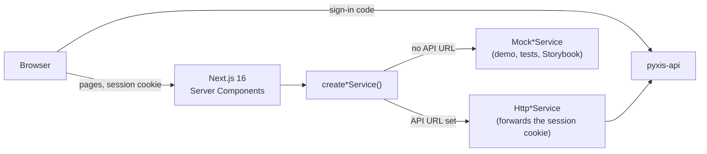

<div align="center">

<picture>
  <source media="(prefers-color-scheme: dark)" srcset=".github/assets/cover-dark.png">
  
</picture>

**The dashboard of Pyxis: the overview, funnels, features, request errors, devices, acquisition and
per-person timelines of a product, measured without cookies or personal data.**

[](https://github.com/samuelcsantana/pyxis-web/actions/workflows/ci.yml)
[](https://codecov.io/gh/samuelcsantana/pyxis-web)
[](https://github.com/samuelcsantana/pyxis-web/actions/workflows/codeql.yml)
[](https://scorecard.dev/viewer/?uri=github.com/samuelcsantana/pyxis-web)
<br>
[](LICENSE)
[](tsconfig.json)
[](https://www.conventionalcommits.org)
[](e2e)
[](https://samuelcsantana.github.io/pyxis-web/)
[](https://demo.pyxis-analytics.dev)

**[Pyxis](https://pyxis-analytics.dev)** · **[Live demo](https://demo.pyxis-analytics.dev)** ·
**[Storybook](https://samuelcsantana.github.io/pyxis-web/)** ·
**[API reference](https://samuelcsantana.github.io/pyxis-api/)** ·
**[SDK playground](https://samuelcsantana.github.io/pyxis-sdk/)**

</div>


| Requests, with a route's details                                                                                                                                                                                           | Funnel, dark theme                                                                                                                                                                                                                                                                                  | Timeline of one person                                                                                                                                                                                                                                 |
| -------------------------------------------------------------------------------------------------------------------------------------------------------------------------------------------------------------------------- | --------------------------------------------------------------------------------------------------------------------------------------------------------------------------------------------------------------------------------------------------------------------------------------------------- | ------------------------------------------------------------------------------------------------------------------------------------------------------------------------------------------------------------------------------------------------------ |
|  |  |  |

The tour and the screenshots show invented demo data: the dashboard runs on it when no API is
configured. The tour was recorded from the [live demo](https://demo.pyxis-analytics.dev).

> **Status:** in production since 2026-10-06 at `app.pyxis-analytics.dev`, with the home page at
> [pyxis-analytics.dev](https://pyxis-analytics.dev) and the same screens on invented data in the
> public [live demo](https://demo.pyxis-analytics.dev).

## Ecosystem

| Repository                                               | Role                                                                                   |
| -------------------------------------------------------- | -------------------------------------------------------------------------------------- |
| [pyxis-api](https://github.com/samuelcsantana/pyxis-api) | Ingestion, sign-in, dashboard queries, accounts and billing, erasure, the MCP endpoint |
| [pyxis-sdk](https://github.com/samuelcsantana/pyxis-sdk) | Browser tracker published to npm as `pyxis-analytics`                                  |
| **pyxis-web** (this one)                                 | The dashboard and the home page                                                        |
| [pyxis-mcp](https://github.com/samuelcsantana/pyxis-mcp) | MCP server: Claude and other agents read the dashboard's numbers                       |

## Why it exists

A product team wants to know which features are used, where requests fail, where a sign-up funnel
loses people and what one person did, in order. Pyxis answers those questions from events that
carry no cookie, no IP address and no personal data. This dashboard is where the answers are read:
an e-mailed code to sign in, no password, and a design that puts the number that matters first.

Read more: [why Pyxis was built and what it never stores][post], the introduction post on the
author's blog, also in [Portuguese][post-pt] and [Spanish][post-es].

[post]: https://www.samuelsantana.dev/en/blog/pyxis-analytics-without-cookies-ip-or-personal-data
[post-pt]: https://www.samuelsantana.dev/blog/pyxis-analytics-sem-cookie-sem-ip-sem-dado-pessoal
[post-es]: https://www.samuelsantana.dev/es/blog/pyxis-analytics-sin-cookies-sin-ip-sin-datos-personales

## Features

- **Eight screens.** Overview, Devices, Acquisition, Features, Requests, Funnel, Timeline and
  Visits, over today, 7 or 30 days or a custom range, narrowed by the same visit filters kept in
  the URL, and each with a CSV export of what it shows.
- **Honest numbers.** A range that ends today is compared with the previous period up to the same
  time of day, a conversion rate counts visits, and one word names one idea on every screen.
- **What changed since the last read.** The menu counts what arrived for each screen, a screen
  offers to refresh when something new arrives, and the Overview shows the visits on the site now.
- **Sign-in and sign-up.** A six-digit code by e-mail; sign-up on the free plan or through Stripe
  Checkout, a first project with its install guide, the Account and billing page and a Help and
  support page.
- **Settings as a window.** Opens over the screen with an address per part (the project's, and
  the person's account and billing, sessions, tokens and apps); opened directly, each is a page.
- **Agents.** Read-only access tokens for agents and scripts, and the consent page and connected
  apps of the Claude connector.
- **Seven languages.** The interface and the home page in English, Brazilian Portuguese, Spanish,
  German, French, Italian and Dutch ([Internationalization](#internationalization)).
- **Accessible by default.** Every Storybook story is also an axe test, text follows the reader's
  font size, every control has hover, pressed and focus states, and nothing moves when the system
  asks for less motion.
- **A live demo** with invented data and no API at all, at
  [demo.pyxis-analytics.dev](https://demo.pyxis-analytics.dev).
- **The home page** of [pyxis-analytics.dev](https://pyxis-analytics.dev), measured by Pyxis's own
  tracker, with the contract and an approximate price in the reader's currency.

Each screen and flow in full is in [docs/FEATURES.md](docs/FEATURES.md), and every component with
its states is in the [Storybook](https://samuelcsantana.github.io/pyxis-web/).

## Internationalization


The dashboard speaks English, Brazilian Portuguese, Spanish, German, French, Italian and Dutch.
English is the default and the source of every text; each other language is a typed translation
of it. The Spanish is neutral (for Spain and Latin America) and addresses the reader as _tú_; the
German uses _du_, the French _vous_, the Italian _tu_ and the Dutch _je_, the usual registers of
software in each. Numbers and dates follow the conventions of Spain (`es`), Germany (`de`),
France (`fr`), Italy (`it`) and the Netherlands (`nl`).

<details>
<summary>How the language is chosen, written and checked</summary>

- **Which language:** the one chosen in the language menu wins, kept in the functional
  `pyxis_locale` cookie; without a choice, the browser's `Accept-Language` decides, matching on
  the language, so `pt-PT` gets Brazilian Portuguese, `es-MX` Spanish, `de-AT` German, `fr-CA`
  French, `it-CH` Italian and `nl-BE` Dutch; otherwise
  English. The address never changes, so links, bookmarks and the demo links work in every
  language.
- **The menu:** each language named in itself (English, Português (Brasil), Español, Deutsch,
  Français, Italiano, Nederlands), with its flag. On the
  home page, the sign-in and the sign-up pages it is a dropdown in the top bar beside the theme
  toggle, showing the flag and the name of the language in use (the flag alone on phones); in the
  dashboard it is in the account menu at the foot of the sidebar. On the sign-in, the sign-up and
  the dashboard it posts to a Server Action and the screen changes language in place, keeping its
  address, its query and what was typed. The choice shows on the click, before the page in that
  language arrives, and the content comes in with the short reveal of a screen change when it
  does (still, when the system asks for reduced motion).
- **Numbers, dates and lists** go through `Intl` in the reader's language and the project's time
  zone: `2.789`, `62,3%`, `9 de set.` in Portuguese, `2789`, `62,3 %`, `9 sept` in Spanish,
  `2.789` in German and Dutch, `2 789` (a narrow no-break space) in French, `2789` in Italian, and
  lists joined with the language's own "and" (`a, b e c`). Plurals follow CLDR, with a zero form
  where the language needs one (Portuguese says "0 visitas").
- **The sign-in email follows:** "Send code" passes the reader's language to the API
  (`locale` on `POST /v1/auth/request-code`), so the code arrives in the language the sign-in
  page was read in; the API falls back to English for a language it has no email for.
- **Customer data is never translated:** event names, paths, routes, status and error codes,
  property keys and values, project names, browser and system names appear as they were sent,
  and CSV files keep English column headers.
- **Checked, not trusted:** a translation that misses or adds a key, or drops or invents a
  placeholder, fails the typecheck; a test walks every translation for the same keys,
  placeholders, rich-text tags and plural categories; `e2e/i18n.spec.ts` opens every translated
  screen in Portuguese, Spanish, German, French, Italian and Dutch with axe, at 1440 and 390px,
  reads the French figures back through its narrow-space separator, and checks the language
  switch round trip.

</details>

## Architecture



Pages read data on the server through service interfaces; the browser calls the API only to ask
for and verify a sign-in code, and hands the token it gets back to a Server Action that keeps it in
a cookie of this host ([ADR 0002](docs/adr/0002-server-components-and-services.md),
[ADR 0008](docs/adr/0008-host-only-session-cookie.md)). The eight screens of the menu share a
layout, `src/app/[projectId]/(screens)/layout.tsx`, whose top bar is a Client Component that reads
the URL and stays mounted from one screen to the next
([ADR 0012](docs/adr/0012-persistent-screen-topbar.md)).

## Tech stack

Next.js 16 (App Router) · React 19 · TypeScript 6 (strict) · Tailwind CSS 4 · Geist through
`next/font` · Zod for API answers, on the server only (the schemas live in
`src/domain/*.schema.ts`, and ESLint keeps Zod and those modules out of `src/components`) · [rx-state-bridge](https://github.com/samuelcsantana/rx-state-bridge)
with RxJS for the few requests a Client Component starts · charts drawn as SVG on the server, each with a
table view ([ADR 0006](docs/adr/0006-server-rendered-svg-charts.md)) · Vitest,
fast-check and Testing Library · Playwright with axe-core · Storybook 10 · Vercel · GitHub Actions with
CodeQL, OpenSSF Scorecard, Dependabot, Codecov and release-please.

## Getting started

Requirements: Node.js 24 and npm 11.

```bash
git clone git@github.com:samuelcsantana/pyxis-web.git
cd pyxis-web
npm ci
npm run dev          # http://localhost:3000
npm run storybook    # http://localhost:6006
```

| Variable                    | Meaning                                                                  |
| --------------------------- | ------------------------------------------------------------------------ |
| `NEXT_PUBLIC_PYXIS_API_URL` | The Pyxis API. Unset: Mock services with invented data and a demo banner |

Without the variable the dashboard runs in demo mode: no session is asked for, and the sign-in
page accepts the code `000000`.

To sign in against a real API, start the [pyxis-api](https://github.com/samuelcsantana/pyxis-api)
compose stack (it accepts sign-in calls from `http://localhost:3000`), grant yourself a project
with its `admin:grant` script, then run the dashboard on port 3000 exactly:

```bash
NEXT_PUBLIC_PYXIS_API_URL=http://localhost:3040 npx next dev -p 3000
```

Outside production the API logs the sign-in code instead of emailing it
(`docker compose logs api`). The dashboard keeps the session in a `__Host-pyxis_session` cookie,
which needs `Secure`: browsers treat `http://localhost` as a secure context, so it works in
development without TLS. The API's local `DASHBOARD_ORIGIN` must be `http://localhost:3000`, the
origin the sign-in and sign-out calls carry.

### Routes

<details>
<summary>Every route and what it shows</summary>

| Route                                                                          | What it shows                                                                                                                                                                                                                                                                                |
| ------------------------------------------------------------------------------ | -------------------------------------------------------------------------------------------------------------------------------------------------------------------------------------------------------------------------------------------------------------------------------------------- |
| `/`                                                                            | Opens the first project the admin may read, or explains there is none                                                                                                                                                                                                                        |
| `/` and `/pt-br`, `/es`, `/de`, `/fr`, `/it`, `/nl` on `pyxis-analytics.dev`   | The home page (demo mode only), rewritten to `/landing/en`, `/landing/pt-br` and so on; asking for those directly answers 308                                                                                                                                                                |
| `/termos`, `/privacidade` and `/acordo-de-tratamento` on `pyxis-analytics.dev` | The contract documents in Portuguese, and `/<language>/terms`, `/privacy`, `/dpa` their courtesy translations (demo mode, once the seller is configured), rewritten to `/legal/<document>`; asking for those directly answers 308                                                            |
| `/[projectId]/exports/[exportId]`                                              | An export of the project's events: being prepared (checked again every few seconds), ready with its download, deleted after a week, or failed                                                                                                                                                |
| `/sign-up`                                                                     | The sign-up (plan, e-mail, terms, code, then Checkout; on the free plan, no plan and no Checkout, or the wait for a free place when it is full), "not open yet" while the API keeps it closed, or the unfinished subscription of a signed-in owner                                           |
| `/welcome?account=<id>`                                                        | Where Checkout returns: waits for Stripe's confirmation, then the trial's end and the first project; an account on the free plan gets its limits and the first project                                                                                                                       |
| `/new-project`                                                                 | A project in the owner's account: name, site address, time zone, conversion event                                                                                                                                                                                                            |
| `/[projectId]/install`                                                         | The snippets with the project's key or a ready request for an AI agent, and the wait for its first event                                                                                                                                                                                     |
| `/account`                                                                     | The owner's accounts: plan, state, events this month against the quota, limits, and Checkout or the billing portal through Stripe; `?next=/account` survives a sign-in                                                                                                                       |
| `/connect?request=<id>`                                                        | The consent page of the Claude connector: allow or cancel an app's request to read the projects, or say that the request ended; not in the demo                                                                                                                                              |
| `/account-suspended`                                                           | Where the screens of a suspended account's projects go: the account is suspended, and the owner finds the reason in Account and billing                                                                                                                                                      |
| `/sign-in`                                                                     | Email, then code; `?expired=1` explains that the session ended; `?next=` returns to that screen                                                                                                                                                                                              |
| `/[projectId]/overview`                                                        | The overview of a project; `?range=today\|7d\|30d` or `?from=…&to=…`; `?metric=` plots a figure                                                                                                                                                                                              |
| `/[projectId]/devices`                                                         | The reach of the visits, device types, browsers, systems, conversion by device, countries, regions and cities                                                                                                                                                                                |
| `/[projectId]/acquisition`                                                     | Visits by channel per day, paid visits, the sources and the campaigns and their conversion                                                                                                                                                                                                   |
| `/[projectId]/features`                                                        | Events (or `?kind=screens`) ranked by use; `?q=` searches by name                                                                                                                                                                                                                            |
| `/[projectId]/requests`                                                        | Writes by route; `?show=failing` and `?screen=/path` filter them; `?route=` opens one                                                                                                                                                                                                        |
| `/[projectId]/funnel`                                                          | `?steps=<json>`, `?mode=visit\|user`; `?step=&outcome=` lists who; none: the editor                                                                                                                                                                                                          |
| `/[projectId]/timeline`                                                        | `?user=<id>` or `?visit=<uuid>`, `?show=` to filter the items; keeps the period for the way back                                                                                                                                                                                             |
| `/[projectId]/visits`                                                          | The visits of the period, with the dashboard filters below plus `route=` (`POST /orders/:id`), a request the visit made                                                                                                                                                                      |
| `/[projectId]/settings`                                                        | The weekly digest switch, sessions (end one or all), access tokens (create, revoke), connected apps (revoke or connect Claude), the project (edited by its owner), keys (created and revoked by the owner), retention, events, people (added and removed by the owner), deleting the project |
| `/[projectId]/help`                                                            | The support address, the reply time of the reader's plan, the installation and question links and the private security report                                                                                                                                                                |
| `/[projectId]/overview/export`                                                 | A CSV file: `?table=daily\|pages\|events` (`daily` when absent), for the screen's period                                                                                                                                                                                                     |
| `/[projectId]/requests/export`                                                 | A CSV file of the routes the Requests screen shows, with its period, `kind`, `show` and `screen`                                                                                                                                                                                             |
| `/[projectId]/features/export`                                                 | A CSV file of the ranking the Features screen shows, with its period, `kind` and `q`                                                                                                                                                                                                         |
| `/[projectId]/acquisition/export`                                              | A CSV file: `?table=sources\|campaigns\|channels` (default `sources`), for the screen's period                                                                                                                                                                                               |
| `/[projectId]/devices/export`                                                  | A CSV file of every breakdown of the Devices screen, for its period                                                                                                                                                                                                                          |
| `/[projectId]/visits/export`                                                   | A CSV file of the newest 1,000 visits matching the Visits screen's period and filters                                                                                                                                                                                                        |
| `/[projectId]/icon`                                                            | The icon of the project's site, cached privately for a day (`?v=` changes with the icon); 404 when the site has none                                                                                                                                                                         |
| `/[projectId]/arrivals`                                                        | JSON for the menu's counts: what arrived in the period (`range` or `from`/`to`) since `?since=`, never cached; an expired session, an unknown project and the API's limit answer 401, 404 and 429                                                                                            |
| `/[projectId]/exports/[exportId]/download`                                     | Redirects to the file through a five-minute link the API signs on each request, or back to the export's page when it is not ready                                                                                                                                                            |
| `/manifest.webmanifest`                                                        | The dashboard's web app manifest; 404 in demo mode                                                                                                                                                                                                                                           |
| `/llms.txt` on `pyxis-analytics.dev`                                           | What Pyxis is and how to install the tracker, for language models and coding agents                                                                                                                                                                                                          |

Every screen route but the Timeline also reads the dashboard filters (`path`, `path2`, `path3`,
`event`, `property`, `channel`, `device`, `browser`, `os`, `identity`, `country`, `region`,
`city`, `source`, `campaign`, `failed`) and sends them to the API's report, and so do their CSV exports.

`src/proxy.ts` sends a visitor without a session cookie to `/sign-in`; the API still decides
whether the session is valid, and a rejected one lands on `/sign-in?expired=1`. Static files never
pass through it, so `public/email/pyxis-logo.png` (and its `@2x`), the raster logo the API's
sign-in email loads, answers without a session. Both carry the
screen that was asked as `?next=`, and the sign-in form goes back to it; only a path of the form
`/<project>/<screen>` on this site is accepted, anything else goes to `/`.

In demo mode the proxy looks at the host the visitor asked for (`x-forwarded-host`, then
`Host`). On `pyxis-analytics.dev` only `/` and the language addresses (`/pt-br`, `/es`, `/de`, `/fr`, `/it`, `/nl`) render, the home page, with the
language named in a request header that `currentLocale()` trusts over the cookie; any other
address there answers 308 to the same address on the demo host, so the demo is never served
twice. Every other request has that header removed. To try the home page locally, send the
header yourself: `curl -H 'x-forwarded-host: pyxis-analytics.dev' http://localhost:3000/`
(a browser cannot simply resolve `pyxis-analytics.dev` to the machine: the whole `.dev` domain
is on the HSTS preload list, so Chromium upgrades it to HTTPS). The `landing-*` Playwright
projects do exactly that.

</details>

### Contract

`contract/openapi.json` is a copy of the API's published contract. `npm run contract:sync`
refreshes it; a unit test checks that the demo answers and the bodies the sign-in form sends
match it, and a daily workflow runs that test against the API's `main`.

### Deployment

Two Vercel projects build this repository, and every merge to `main` deploys both:

| Project      | Address                                                                               | `NEXT_PUBLIC_PYXIS_API_URL`       |
| ------------ | ------------------------------------------------------------------------------------- | --------------------------------- |
| `pyxis-web`  | `https://app.pyxis-analytics.dev`, the dashboard for the projects' admins             | `https://api.pyxis-analytics.dev` |
| `pyxis-demo` | [`https://demo.pyxis-analytics.dev`](https://demo.pyxis-analytics.dev), the live demo | unset                             |

<details>
<summary>Its settings, the contract pages and what deploys</summary>

The demo's project also builds the home page. `NEXT_PUBLIC_LANDING_PYXIS_KEY` (the public key of
the Pyxis project that measures the home page) turns its measurement on;
`NEXT_PUBLIC_LANDING_PYXIS_ENDPOINT` overrides the ingestion URL, which defaults to
`https://api.pyxis-analytics.dev` (the e2e suite points it at the local server and answers the
batches itself). `EXCHANGE_RATES_URL` (server only) overrides where the pricing section reads the
euro reference rates, by default the European Central Bank's daily file; the e2e suite points it
at an address of the local server that answers 404, so the suite never reaches the bank and the
approximate price stays hidden there.

The contract of the hosted service (terms of use, privacy policy and data processing agreement,
in Portuguese, the language of the contract) lives in `content/legal` as Markdown and is served by
the demo's project at `/termos`, `/privacidade` and `/acordo-de-tratamento` on the main domain.
Courtesy translations in the six other interface languages live in `content/legal/<language>/`
and are served at `/<language>/terms`, `/<language>/privacy` and `/<language>/dpa` (`en`, `es`,
`de`, `fr`, `it`, `nl`); each says the Portuguese text prevails and links it
([ADR 0011](docs/adr/0011-courtesy-translations-of-the-contract.md)). The
seller is configuration, not code, so this public repository never holds a person's tax id or
address: `SELLER_NAME`, `SELLER_TAX_ID` and `SELLER_ADDRESS` (server-only, set on **both**
projects, since the sign-up page on `app.` shows the same identification) fill the documents and
the seller line that Decreto 7.962/2013 asks a consumer offer to show; `TERMS_EFFECTIVE_DATE`
(`YYYY-MM-DD`) fills the effective date, and without it the documents say they start with the
sign-up. Until all three seller variables are set, the pages answer as any other address, and
neither the home page footer nor the sign-up page links them. A change to these variables needs a
redeploy.

Only `main` deploys: `vercel.json` turns Git deployments off for every other branch, so pull
requests get no preview deployment and spend no build minutes. Check a change
locally instead (`npm run dev`, or the e2e suite on a production build). `vercel.json` also runs
the functions in `gru1` (São Paulo), the city of the API, because every page reads it on the
server.

</details>

## Testing

```bash
npm run test:cov        # unit tests in jsdom, 100% coverage required
npm run test:e2e        # Playwright, axe (WCAG 2.2 AA + best practices), light/dark, desktop/phone
npm run test:storybook  # every story in headless Chromium, axe violations fail the run
npm run test:tooling    # the lint rules, the comment check and the bundle budget
npm run budget          # after a build: first-load JavaScript of each route against its budget
```

Coverage must stay at **100% of statements, branches, functions and lines** of `src/`; CI fails
below it. Excluded, and why:

| Excluded                    | Reason                                                  |
| --------------------------- | ------------------------------------------------------- |
| `src/**/*.stories.tsx`      | Documentation, run as browser tests by `test:storybook` |
| `eslint-rules/`, `scripts/` | Tooling outside `src/`, tested on Node's test runner    |

The root layout is covered too: its test calls the server component and checks the document it
returns.

Property-based tests, `src/domain/*.property.test.ts`, check the rules of pure domain functions
over generated inputs with [fast-check](https://fast-check.dev/), next to the example-based tests
of the same module:

| Module                   | Rule checked over generated inputs                                                                                                                                                                 |
| ------------------------ | -------------------------------------------------------------------------------------------------------------------------------------------------------------------------------------------------- |
| `csv.ts`                 | No text cell reaches a spreadsheet starting with `=`, `+`, `-`, `@`, a tab or a carriage return; every field reads back through a strict RFC 4180 reader; one record per row, one field per column |
| `chart-scale.ts`         | The axis climbs from zero in at most five equal whole steps to the first step at or above the highest value; `plotY` keeps a value within the axis inside the plot, in order                       |
| `donut.ts`               | The arcs go round the circle once, each starting where the previous one ended, to the hundredth they are written in                                                                                |
| `identifier-segments.ts` | The segments join back into the text, none is empty, and every cut falls right after a separator                                                                                                   |

They run with the unit tests, under one fixed seed and run count (`src/test-utils/property-run.ts`),
so CI and the pre-commit hook see the same inputs; a failure prints the counterexample, shrunk to
the smallest input that breaks the rule. fast-check is a dev dependency and never reaches the
browser bundle.

Tests run in English: the Vitest setup file replaces `currentLocale()`, the only code that reads
the request's language, so a test never needs request headers to render a page. Domain functions
and server components that write text take the request's `I18n` value (translator and formats)
as an argument, and their tests pass the `english` one from `src/test-utils/english.ts`, or
`portuguese`, `spanish`, `german`, `french`, `italian` or `dutch` from `src/test-utils/` to check a
sentence in another language. Client
Components read their text with `useT()` from the messages provider, so their tests, and the tests
of any page that contains one, render through `renderWithMessages`, which wraps the tree in the
provider with the English messages the browser receives. A Client Component that only shows words
gets them ready from the server instead, as a `…Text` object built by a domain function (the
Requests, Timeline and Visits tables do this), so those words travel with the page that needs
them and not with every page; their tests pass the object built with `english`.

A local ESLint rule, `no-literal-jsx-text`, keeps interface text out of the components: words
written in JSX, or in an `aria-label`, `title`, `alt`, `placeholder`, `label` or `subtitle`, fail
the lint, so every word on a screen comes from `src/i18n/messages/en.ts` and can be translated.
Punctuation, symbols and numbers pass, and so does the "Pyxis" wordmark. Tests, stories and the
Storybook-only design pages in `src/design/` are outside it.

### Performance budget

The CI `build` job fails when a route's first-load JavaScript (every first-load chunk, gzip
level 9, from `.next/diagnostics/route-bundle-stats.json`) goes over the budget of its class.
Each budget is the size measured when it was set plus 5%, and is raised only in a pull request
that says why:

| Route class                                            | Budget (KiB gzip) |
| ------------------------------------------------------ | ----------------- |
| Sign-in, home and not-found pages                      | 155               |
| Sign-up page                                           | 162               |
| Dashboard screens without a chart, and Settings pages  | 174               |
| Dashboard screens with a chart (Overview, Acquisition) | 171               |

A chart adds no JavaScript: Overview and Acquisition draw theirs as SVG on the server
([ADR 0006](docs/adr/0006-server-rendered-svg-charts.md)), so the chart is in the first paint and
the two screens loaded 154.1 KiB when that change landed, down from about 256 KiB with Recharts.

<details>
<summary>How each budget grew</summary>

The budget went from 162 to 163 KiB
with the sliding period presets, a client component of about 1 KiB that moves the indicator on
the click, before the next page arrives, and to 165 KiB with the sliding indicators of the other
switches, the tabs and the theme choice (about 1.4 KiB on these two screens: a hook that measures
the chosen item and the indicator it places, shared with the click-ahead state of the presets).
The sign-in budget went from 152 to 153 KiB with the sliding language switch: the language menu
became a client component that moves the indicator on the click, before the page in the new
language arrives, and brings the content in when it does (about 1.1 KiB, the same indicator hook
as the other switches). The code step's own work in the same release (the six cells, the page's
own messages, the resend wait and the step kept through a reload) had taken the page from 149.5
to 151.3 KiB. The sign-in budget then went to 155 KiB and the chart budget to 166 KiB with the
preference carrier, which adds the chosen language and theme to the links between the home page,
the dashboard and the live demo, so a visitor who changes either keeps it on the next address: it
measured 154.1 KiB on the sign-in page (1.4 KiB more: about 1 KiB of code, the rest the shared
chunk it splits off) and 165.3 KiB on Overview (0.5 KiB more). The sign-up page has its own
budget, 162 KiB: it measured 159.4 KiB, the sign-in's shell plus the sign-up form, the code
cells, the terms and the Checkout step (its answers are read without a schema library, as the
sign-in's are, which took it down from 251 KiB). The chart budget went to 167 KiB in the same pull
request: with the sign-up page sharing part of the dashboard's shell, the bundler split a shared
chunk in two, and the two halves compress 1.1 KiB worse on every dashboard screen (166.6 KiB on
Overview) without any code added to them. Moving the top bar of the eight screens into their
layout ([ADR 0012](docs/adr/0012-persistent-screen-topbar.md)) put the period code and the header
in the browser: 166.0 KiB on Overview (0.3 KiB more than before it) and 168.8 KiB on Requests. In
the same change the pages stopped importing the period selector's module for a URL helper, so
the routes without a selector no longer load its client components (Settings 165.7 KiB, 2.4 KiB
less). Keeping visited screens in the client cache and reading a stale one again
([ADR 0013](docs/adr/0013-a-visited-screen-comes-back-from-the-client-cache.md)) took Overview to
166.8 KiB and Requests to 169.6 KiB. The menu's counts of what arrived
([ADR 0014](docs/adr/0014-arrivals-are-polled-not-streamed.md)) load their watcher on demand,
after the page is shown; what every screen loads to draw them took Overview to 167.6 KiB and
Requests to 170.5 KiB. For them the chart budget went to 169 KiB and the screen budget to 172 KiB,
sized for the four tasks of that work (the counts, the "new · Refresh" bar, the visitors on the
site now, the "+N" on the numbers), each of which draws its part from what the same watcher
loads; every one still reports its first-load JavaScript. The "new · Refresh" bar took Overview to
168.2 KiB and Requests to 171.0 KiB; the visits on the site now took them to 168.5 KiB and
171.3 KiB. The "+N" marks fill slots the server draws, from the watcher's chunk
([ADR 0015](docs/adr/0015-fresh-numbers-fill-server-drawn-slots.md)): Overview stayed at
168.5 KiB, and the two tables drawn in the browser carry the slot (Requests 171.6 KiB, Visits
171.0 KiB). Settings as a window ([ADR 0016](docs/adr/0016-settings-as-a-window-with-an-address.md))
puts a small host on every project route and loads the dialog on demand, after the page is shown:
0.1 KiB more on every screen (Overview 170.1 KiB, Requests 173.1 KiB). Each part of Settings is its
own route that loads only its own forms (163.7–167.8 KiB, down from 169.4 KiB for the whole page);
the person's parts opened outside a project (`/account/sessions`, `/account/tokens`,
`/account/apps`, 153.2–155.0 KiB) count as Settings pages, not entry pages. Account and billing
joined them as a part of the window: `/account` went from 152.8 to 155.7 KiB with the window's
menu and counts as a Settings page too.

</details>

## Project structure

```text
src/
├── app/            routes, the root layout, design tokens (globals.css), icons
├── components/     UI components by screen and area (shell, overview, visits, settings, account,
│                   sign-up, landing, legal…), each with its stories
├── design/         the design tokens page
├── domain/         pure types and rules: the admin and projects, periods, overview figures,
│                   rates and changes, sparklines, chart scales, day labels, lines and
│                   stacked bars, the Overview chart for each figure, device, country and region labels, donuts,
│                   channels and sources, feature ranking, search and property breakdowns,
│                   routes and failures, funnel steps and counts, timeline items, visit
│                   filters and rows, CSV files and each screen's tables, errors; the Zod
│                   schemas of the API answers sit apart in *.schema.ts, imported by the
│                   server only
├── i18n/           interface languages: Accept-Language negotiation, typed dictionaries with
│                   CLDR plurals, rich() for the elements inside a sentence, the number and
│                   date formats of each language, the request's language and the messages
│                   provider
├── lib/            API configuration, theme, security headers, the current admin, CSV exports
├── services/       one interface per API area, with Http and Mock implementations
├── test-utils/     test helpers (rendering inside the messages provider, the English,
│                   Portuguese, Spanish, German, French, Italian and Dutch I18n)
└── proxy.ts        sends a visitor without a session to sign in
contract/           the API contract copied from pyxis-api
public/email/       the raster logo the API's sign-in email loads (PNG, 1x and 2x)
e2e/                Playwright specs and the axe helper
.storybook/         Storybook configuration
eslint-rules/       the local ESLint rules: no comments, no literal text in JSX, no font sizes in px
scripts/            the comment check for files ESLint does not read
docs/adr/           architecture decision records
```

## Privacy and security

- **A nonce Content Security Policy on every page.** Scripts run only with the request's nonce
  (`'strict-dynamic'`), connections go only to this origin and the Pyxis API, and no page can be
  framed ([ADR 0009](docs/adr/0009-csp-with-nonces.md)).
- **No secret in the browser.** Data is read on the server through service interfaces
  ([ADR 0002](docs/adr/0002-server-components-and-services.md)), and changes go through Server
  Actions that re-check access and validate what the browser sent.
- **A token or a secret key is shown once** and never written to a cookie, storage or the page's
  HTML; lists show names and dates, never a token.
- **A host-only session cookie.** `__Host-pyxis_session`, `HttpOnly`, `Secure`, `SameSite=Lax`,
  set by a Server Action of this host; the only other cookies hold the theme and the language, and
  neither identifies anyone ([ADR 0008](docs/adr/0008-host-only-session-cookie.md)).
- **Nothing confirms an account.** The sign-in screen says the same thing for every e-mail, like
  the API it calls.
- **The live demo has no API configured at all**, so it cannot reach real data.
- **Logs without people.** Each read of the API logs the route template, the status and the
  duration: no project id, no query value, no cookie, nothing about the person signed in.
- Vulnerabilities: see [SECURITY.md](SECURITY.md).

The rules in full (the consent page, the CSV exports, the exchange rates, what search engines may
index) are in [docs/FEATURES.md](docs/FEATURES.md#privacy-and-security-in-detail).

## Architecture decisions

| ADR                                                                        | Decision                                                          |
| -------------------------------------------------------------------------- | ----------------------------------------------------------------- |
| [0001](docs/adr/0001-record-architecture-decisions.md)                     | Record architecture decisions                                     |
| [0002](docs/adr/0002-server-components-and-services.md)                    | Server Components reading through service interfaces              |
| [0003](docs/adr/0003-csp-without-nonces.md)                                | A Content Security Policy without nonces (superseded by 0009)     |
| [0004](docs/adr/0004-client-request-state-with-rx-state-bridge.md)         | Request state of Client Components with rx-state-bridge           |
| [0005](docs/adr/0005-charts-with-recharts-and-a-table-view.md)             | Charts with Recharts, each with a table view (superseded by 0006) |
| [0006](docs/adr/0006-server-rendered-svg-charts.md)                        | Charts drawn as SVG on the server, each with a table view         |
| [0007](docs/adr/0007-interface-languages-typed-dictionaries.md)            | Interface languages with typed dictionaries, a cookie and Intl    |
| [0008](docs/adr/0008-host-only-session-cookie.md)                          | Keep the session in a host-only cookie set by a Server Action     |
| [0009](docs/adr/0009-csp-with-nonces.md)                                   | A Content Security Policy with a nonce per request                |
| [0010](docs/adr/0010-home-page-language-kept-on-the-device.md)             | Home page language kept on the device, and the browser's at `/`   |
| [0011](docs/adr/0011-courtesy-translations-of-the-contract.md)             | Courtesy translations of the contract, the Portuguese prevailing  |
| [0012](docs/adr/0012-persistent-screen-topbar.md)                          | The top bar of the eight screens stays mounted between them       |
| [0013](docs/adr/0013-a-visited-screen-comes-back-from-the-client-cache.md) | A visited screen comes back from the client cache                 |
| [0014](docs/adr/0014-arrivals-are-polled-not-streamed.md)                  | Arrivals are polled, not streamed, and counted on the device      |
| [0015](docs/adr/0015-fresh-numbers-fill-server-drawn-slots.md)             | What went up since the last read fills slots the server drew      |
| [0016](docs/adr/0016-settings-as-a-window-with-an-address.md)              | Settings is a window with an address                              |

## Roadmap

What shipped, release by release, is in the [CHANGELOG](CHANGELOG.md) and the
[GitHub releases](https://github.com/samuelcsantana/pyxis-web/releases).

## Contributing and license

See [CONTRIBUTING.md](CONTRIBUTING.md) and the [Code of Conduct](CODE_OF_CONDUCT.md). Released
under the [MIT License](LICENSE).
